 

 

  

 

## 👨‍💻 About Me

 

I'm an **AI/ML engineer** and **Generative AI enthusiast** who turns models into products — LLM-powered apps, data platforms and ML tooling built with **Python, FastAPI, Django and React**. I like owning a project end to end, from the data and the model to the last pixel on screen.

👇 &nbsp;Tap a row to see what's behind it

 

<b>🧠&nbsp; Focus</b> &nbsp;—&nbsp; Generative AI, LLM apps and data &amp; ML platforms

 

| Project | What it does |
|---|---|
| 🧭&nbsp;[**DataPilot**](https://github.com/Rahul-134/datapilot) | Ask questions of your data in plain English, scrape the web with AI, and train ML models — all in one workspace |
| 📓&nbsp;[**BitNote**](https://github.com/Rahul-134/bitnote) | Notion-style notebooks with an AI tutor: syllabuses, learning roadmaps and recall quizzes |
| 🎯&nbsp;[**BitCareer**](https://github.com/Rahul-134/bitcareer-showcase) | A learning and career-readiness platform with AI mock interviews and skill analysis |

 

<b>🧩&nbsp; Problem solving</b> &nbsp;—&nbsp; 160+ LeetCode problems solved

 

- 🧮 **160+ problems solved** on LeetCode, with 60+ of the solutions written up in [leetcode-solutions-python](https://github.com/Rahul-134/leetcode-solutions-python) — each one runnable, type-hinted and shipped with a built-in test case
- 🗂️ Arrays &amp; hashing · strings · two pointers · sliding window · dynamic programming · bit manipulation
- 📈 Live numbers on my [LeetCode profile](https://leetcode.com/Rahul_134), or [jump to the stats card ↓](#-leetcode)

 

<b>🚀&nbsp; Builds</b> &nbsp;—&nbsp; AI co-pilots, web apps and interactive console games

 

| | Where to look |
|---|---|
| 🤖&nbsp;**AI&nbsp;co&#8209;pilots** | [DataPilot](https://github.com/Rahul-134/datapilot) · [BitNote](https://github.com/Rahul-134/bitnote) |
| 🌐&nbsp;**Web&nbsp;apps** | [BitCareer](https://github.com/Rahul-134/bitcareer-showcase) · [BitNote](https://github.com/Rahul-134/bitnote) |
| 🎮&nbsp;**Games** | [Virtual Arcade Zone](https://github.com/Rahul-134/virtual-arcade-zone) — 7 console mini-games in pure Java · [Business Bytes](https://github.com/Rahul-134/business-bytes-showcase) — a desktop Monopoly · 🦖 [**play the dino game**](https://rahul-134.github.io/Rahul-134/dino/) |

More in [Featured Projects ↓](#-featured-projects)

 

 

## 🛠️ Tech Stack

**Languages**

**Frameworks & Libraries**

**Databases**

**Tools & Platforms**

 

## 🚀 Featured Projects

A selection of things I've designed, built and shipped — click a card to open the project, or peek inside.

 

<!-- ───────────── 01 · BitCareer ───────────── -->

📸&nbsp; <b>Peek inside BitCareer</b> &nbsp;—&nbsp; 5 screens

 

 <b>Career Dashboard</b> — readiness score, resume and GitHub analysis, skill ranks and an AI-written career analysis

 <b>Learning Workspace</b> — roadmap sidebar, study notebook and code sandbox in one place

 <b>AI Interview Dashboard</b> — configure a session, then review past sessions and score trends

 <b>Live Interview Session</b> — speak or type your answer, or switch to the code editor

 <b>Ask BitBuddy</b> — a personalised career overview with daily AI insights

Full write-up in the <a href="https://github.com/Rahul-134/bitcareer-showcase">repository ↗</a>

 

<!-- ───────────── 02 · BitNote ───────────── -->

📸&nbsp; <b>Peek inside BitNote</b> &nbsp;—&nbsp; 4 screens

 

 <b>Sign up &amp; log in</b> — email and password, or Google Sign-In

 <b>Home</b> — all your notebooks in one place

 <b>Notebook layout</b> — an AI-generated learning roadmap beside the cell editor

 <b>In-cell AI</b> — instant summaries and BitBuddy chat, in context of the cell

Setup, API and deployment notes in the <a href="https://github.com/Rahul-134/bitnote">repository ↗</a>

 

<!-- ───────────── 03 · DataPilot ───────────── -->

📸&nbsp; <b>Peek inside DataPilot</b> &nbsp;—&nbsp; what's inside

 

- 📊 **Dashboard** — upload CSV or Excel files for instant stats, a data health score and a column profile
- 🧹 **Data cleaning** — remove duplicates and handle nulls with a live preview, then download the cleaned file
- 💬 **Natural-language analysis** — ask in plain English (or by voice); Gemini writes the pandas code, which is shown for transparency, and returns the results
- 🕸️ **AI web scraper** *(beta)* — URL and search modes with pagination detection, relevance filtering and a multi-model fallback
- 🤖 **ML trainer** — regression and classification with automatic hyperparameter tuning, reports, predictions, seven chart types and Python code export

Architecture and API reference in the <a href="https://github.com/Rahul-134/datapilot">repository ↗</a>

 

<!-- ───────────── 04 · Business Bytes ───────────── -->

📸&nbsp; <b>Peek inside Business Bytes</b> &nbsp;—&nbsp; 6 screens

 

 <b>Main menu</b> — start, load a saved game or read how to play

 <b>Login &amp; sign up</b> — accounts with live password-strength feedback

 <b>Player setup</b> — 2–4 players, custom names and tokens

 <b>Game board</b> — a circular board of Indian cities

 <b>Load game</b> — resume any of your saved games

 <b>Leaderboard</b> — net-worth ranking when the game ends

Design notes in the <a href="https://github.com/Rahul-134/business-bytes-showcase">repository ↗</a>

 

### 🧩 More Builds

 

 

## 📊 GitHub Activity

 

 

 

## 🧮 LeetCode

 

## 🤝 Let's Connect

I'm always open to interesting projects and conversations about AI, backend engineering and building useful products. Reach out on [LinkedIn](https://www.linkedin.com/in/rahul-lumbhani-89304130b/) or follow along here on [GitHub](https://github.com/Rahul-134).

 

