<!-- theme:header -->

<a href="https://rahul-134.github.io/Rahul-134/dino/">
  <picture>
    <source media="(max-width: 600px)" srcset="dino-banner-mobile.svg" />
    
  </picture>
</a>

 

 

 

 

<!-- theme:about -->
<h2 id="about-me"><picture>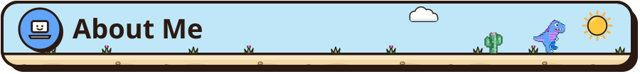</picture></h2>

 


<picture>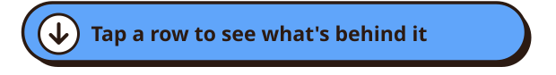</picture>

 

<picture>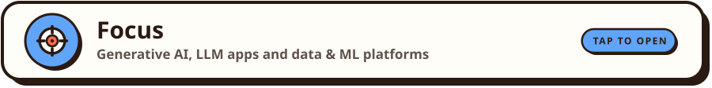</picture>

 

<a href="https://github.com/Rahul-134/datapilot">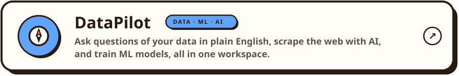</a>
<a href="https://github.com/Rahul-134/bitnote">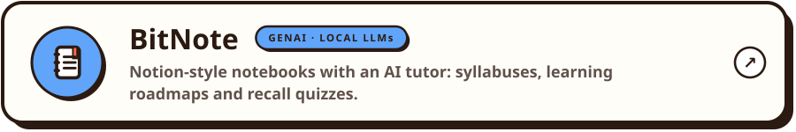</a>
<a href="https://github.com/Rahul-134/bitcareer-showcase">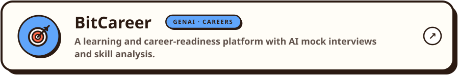</a>

 

<picture>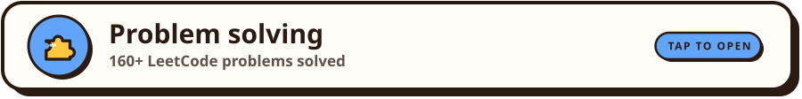</picture>

 

<a href="https://github.com/Rahul-134/leetcode-solutions-python">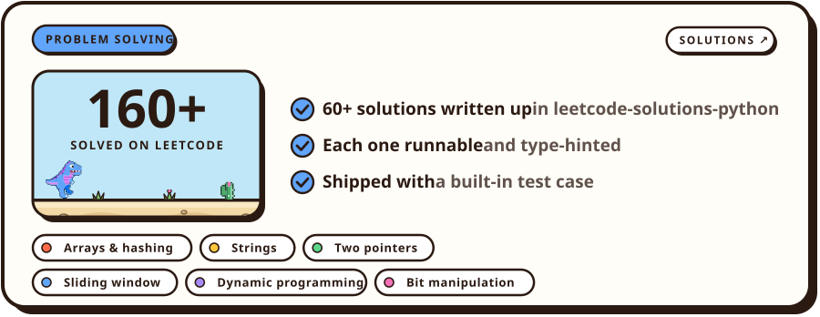</a>

 

<picture>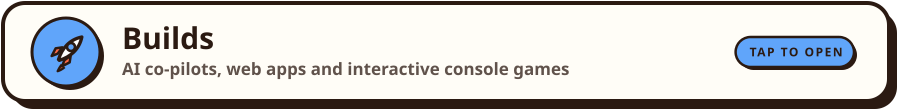</picture>

 

<a href="https://github.com/Rahul-134/datapilot">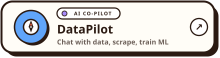</a>
<a href="https://github.com/Rahul-134/bitnote">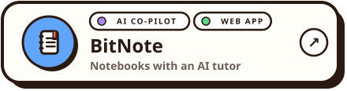</a>
<a href="https://github.com/Rahul-134/bitcareer-showcase">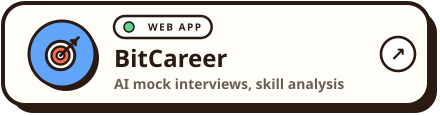</a>
<a href="https://rahul-lumbhani-portfolio.vercel.app/">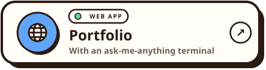</a>
<a href="https://github.com/Rahul-134/virtual-arcade-zone">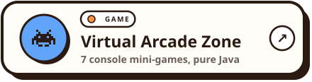</a>
<a href="https://github.com/Rahul-134/business-bytes-showcase">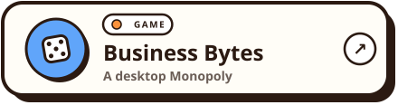</a>
<a href="https://rahul-134.github.io/Rahul-134/dino/">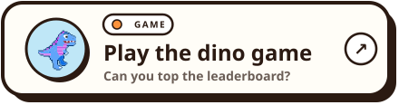</a>

 

 

<h2 id="tech-stack"><picture>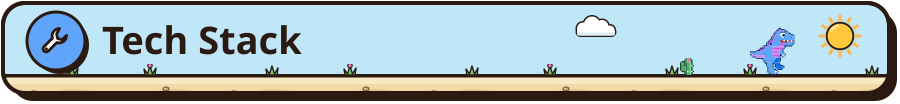</picture></h2>

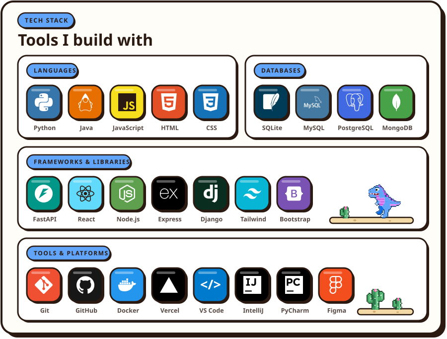

 

<!-- theme:projects -->
<h2 id="featured-projects"><picture>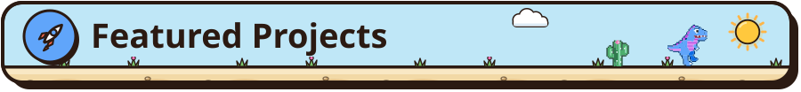</picture></h2>

<picture>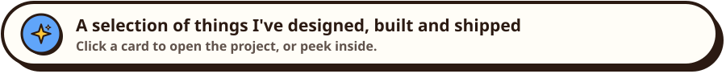</picture>

 

<!-- ───────────── 01 · BitCareer ───────────── -->

<picture></picture>

 

 <picture>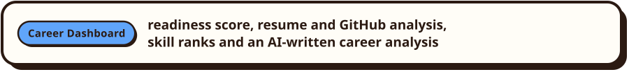</picture>

 <picture>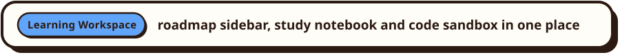</picture>

 <picture>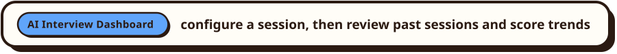</picture>

 <picture></picture>

 <picture></picture>

 

<!-- ───────────── 02 · BitNote ───────────── -->

<picture></picture>

 

 <picture></picture>

 <picture></picture>

 <picture></picture>

 <picture></picture>

 

<!-- ───────────── 03 · DataPilot ───────────── -->

<a href="https://datapilot-ml-trainer.streamlit.app/">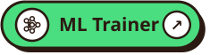</a>

<picture></picture>

 

<picture></picture>

<picture>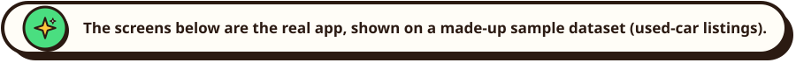</picture>

 <picture>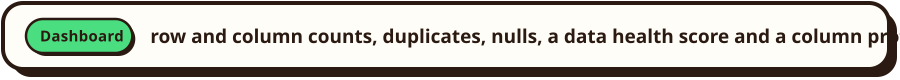</picture>

 <picture>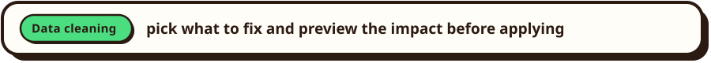</picture>

 <picture>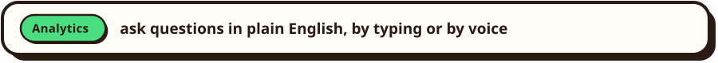</picture>

 <picture>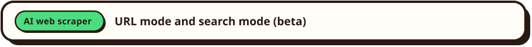</picture>

 <picture>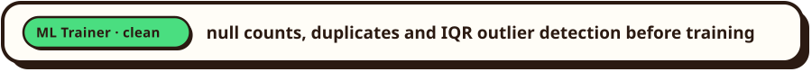</picture>

 <picture></picture>

 <picture>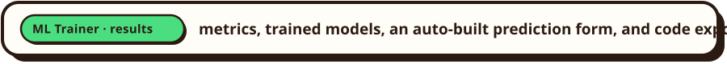</picture>

 

 

<!-- ───────────── 04 · Business Bytes ───────────── -->

<picture></picture>

 

 <picture>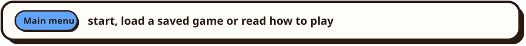</picture>

 <picture></picture>

 <picture></picture>

 <picture></picture>

 <picture></picture>

 <picture></picture>

 

<!-- ───────────── 05 · Portfolio ───────────── -->

<a href="https://rahul-lumbhani-portfolio.vercel.app/">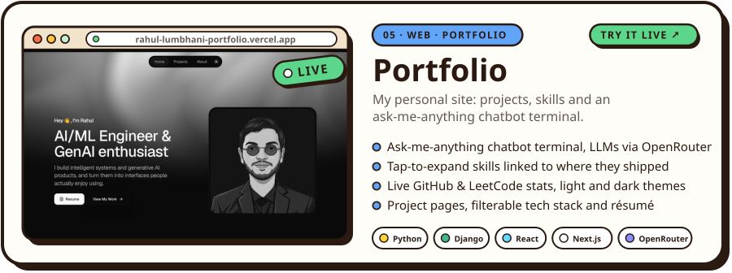</a>

<picture></picture>

 

 <picture>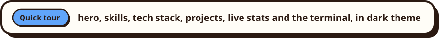</picture>

 <picture>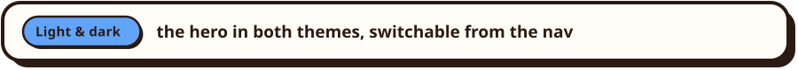</picture>

 <picture></picture>

 <picture></picture>

 <picture></picture>

 <picture></picture>

 <picture></picture>

 <picture>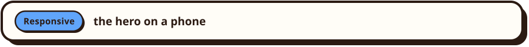</picture>

 

<h3 id="more-builds"><picture>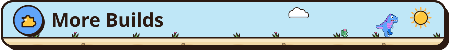</picture></h3>

 

 

<!-- theme:activity -->
<h2 id="github-activity"><picture>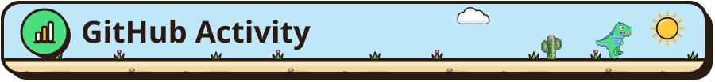</picture></h2>

<a href="https://github.com/Rahul-134">
  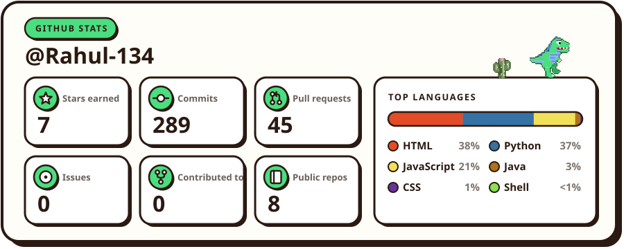
</a>

  

<a href="https://github.com/Rahul-134">
  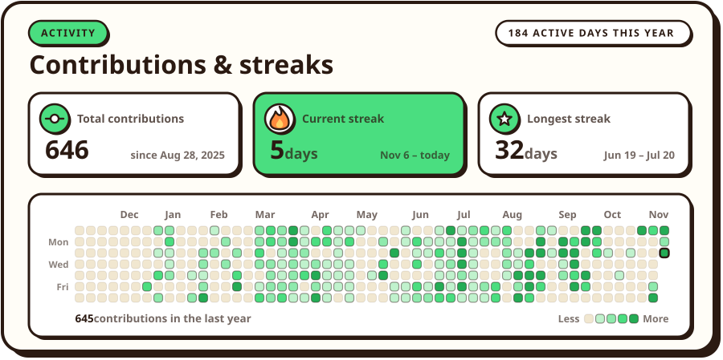
</a>

 

<h2 id="leetcode"><picture>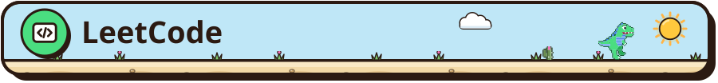</picture></h2>

<a href="https://leetcode.com/u/Rahul_134/">
  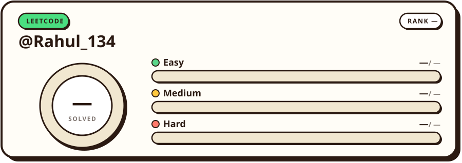
</a>

 

<!-- theme:connect -->
<h2 id="lets-connect"><picture>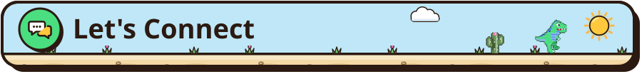</picture></h2>


<a href="https://www.linkedin.com/in/rahul-lumbhani-89304130b/"></a>
<a href="https://github.com/Rahul-134"></a>
<a href="https://rahul-lumbhani-portfolio.vercel.app/"></a>
<a href="https://rahul-134.github.io/Rahul-134/dino/"></a>

