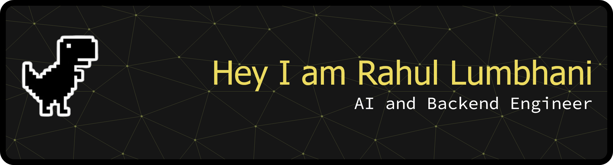

<!-- 
Hi, My name is Rahul Lumbhani
 -->

  

<h1>About Me</h1>

<ul><li>Full‑stack developer leveraging JavaScript, React, Node.js, and Python to build scalable web and AI solutions.</li></ul><ul><li>Specializes in AI‑driven data platforms and productivity tools, delivering end‑to‑end products with FastAPI, SQLite, and vanilla JS.</li></ul><ul><li>Proven track record solving algorithmic challenges and building AI co‑pilot, web apps, and interactive console games.</li></ul><ul><li>Working across Python, HTML, Java, JavaScript</li></ul>

  
## Tech Stack

### Languages:

  &nbsp;&nbsp;&nbsp;
  &nbsp;&nbsp;&nbsp;
  &nbsp;&nbsp;&nbsp;
  &nbsp;&nbsp;&nbsp;
  &nbsp;&nbsp;&nbsp;

### Libraries & Frameworks:

  &nbsp;&nbsp;&nbsp;
  &nbsp;&nbsp;&nbsp;
  &nbsp;&nbsp;&nbsp;
  &nbsp;&nbsp;&nbsp;
  &nbsp;&nbsp;&nbsp;
  &nbsp;&nbsp;&nbsp;
  

### Tools & Platforms:

  &nbsp;&nbsp;&nbsp;
  &nbsp;&nbsp;&nbsp;
  &nbsp;&nbsp;&nbsp;
  &nbsp;&nbsp;&nbsp;
  &nbsp;&nbsp;&nbsp;
  &nbsp;&nbsp;&nbsp;
  &nbsp;&nbsp;&nbsp;
  &nbsp;&nbsp;&nbsp;

### Databases:

  &nbsp;&nbsp;&nbsp;
  &nbsp;&nbsp;&nbsp;
  &nbsp;&nbsp;&nbsp;
  &nbsp;&nbsp;&nbsp;

  
## Find Me Online

  &nbsp;&nbsp;&nbsp;
  &nbsp;&nbsp;&nbsp;

### My GitHub Stats

### My LeetCode Stats

<!--  -->

